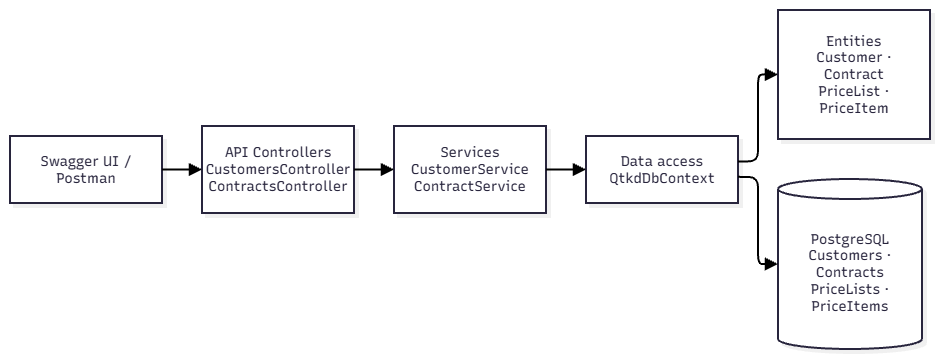

# QTKD — Phase 2, Tuần 05

Web API dùng ASP.NET Core .NET 10, Entity Framework Core và PostgreSQL. Tuần 05 tạo nền tảng dữ liệu và các API đọc Customer/Contract.

Sơ đồ thành phần: [docs/architecture.md](docs/architecture.md).



## Yêu cầu

- Git
- .NET SDK 10
- PostgreSQL đang chạy trên máy
- Công cụ EF Core CLI (`dotnet-ef`) phiên bản 10

## Lấy source trên máy mới

Trong PowerShell, chuyển tới thư mục muốn chứa project rồi chạy:

```powershell
git clone https://github.com/NguyenHoLe/QTKD-Phase2.git
cd QTKD-Phase2
dotnet restore
dotnet build QTKD.sln
```

## Cấu hình database

Đảm bảo PostgreSQL đang chạy và tài khoản trong connection string có quyền tạo database. Lệnh `dotnet ef database update` bên dưới sẽ tạo database `qtkd` nếu chưa có và áp dụng các migration. Không lưu mật khẩu trong source code hoặc commit lên Git.

Project đã có `UserSecretsId`. Trong PowerShell, lưu connection string cục bộ bằng lệnh sau; thay `YOUR_POSTGRES_PASSWORD` bằng mật khẩu PostgreSQL của bạn. Nếu dùng username khác `postgres`, thay username tương ứng.

```powershell
dotnet user-secrets set "ConnectionStrings:Qtkd" 'Host=localhost;Port=5432;Database=qtkd;Username=postgres;Password=YOUR_POSTGRES_PASSWORD' --project QTKD.Api
```

## Cài công cụ EF Core CLI

Nếu chưa cài `dotnet-ef`:

```powershell
dotnet tool install --global dotnet-ef --version 10.0.14
```

Nếu đã cài phiên bản 10 khác, có thể cập nhật để khớp phiên bản EF Core Design của project:

```powershell
dotnet tool update --global dotnet-ef --version 10.0.14
```

## Tạo/cập nhật database

Chạy từ thư mục chứa `QTKD.sln`:

```powershell
dotnet ef database update --project QTKD.Api
```

Lệnh này áp dụng các migration trong `QTKD.Api/Migrations`. Migration `AddSampleData` thêm dữ liệu mẫu: hai Customer, một Contract Draft và một PriceList có hai PriceItem. Mã dịch vụ và đơn giá chỉ là dữ liệu minh họa.

## Khởi động API

```powershell
dotnet run --project QTKD.Api
```

Xem địa chỉ `https://localhost:<port>` hoặc `http://localhost:<port>` được in ra trong terminal khi ứng dụng khởi động.

## Thử API bằng Swagger UI hoặc Postman

Khi ứng dụng chạy trong môi trường Development, mở Swagger UI tại `http://localhost:<port>/swagger`. Thay `<port>` bằng cổng được in ở bước khởi động. Chọn `GET /api/customers` hoặc `GET /api/contracts/{id}`, bấm **Try it out**, nhập `1` làm `id` cho Contract, rồi bấm **Execute**.

Có thể thử bằng Postman hoặc trình duyệt với các URL sau:

| Method | URL | Kết quả mong đợi |
|---|---|---|
| GET | `http://localhost:<port>/api/customers` | Danh sách có Công ty Minh Phát và Công ty An Bình |
| GET | `http://localhost:<port>/api/contracts/1` | Hợp đồng HD-2026-018, trạng thái Draft, khách hàng Công ty Minh Phát |

Nếu Postman báo lỗi chứng chỉ HTTPS local, thử URL `http://localhost:<port>` nếu terminal có in địa chỉ HTTP.
