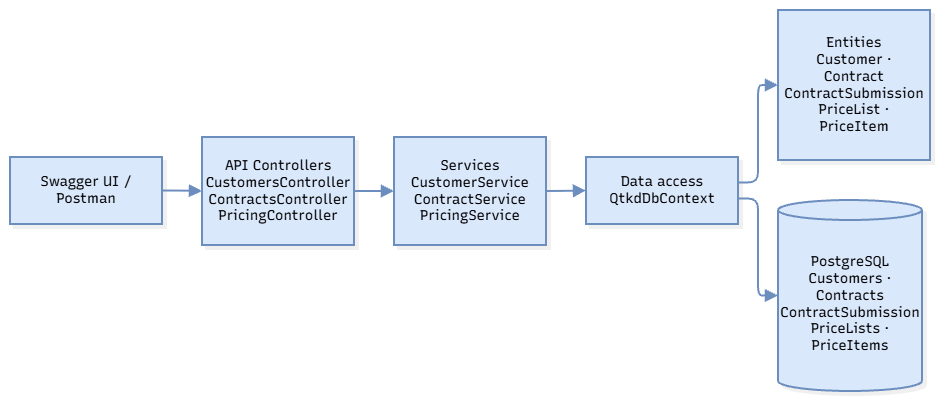

# QTKD — Phase 2, Tuần 05–07

Web API dùng ASP.NET Core .NET 10, Entity Framework Core và PostgreSQL. Nội dung theo tuần:
- **Tuần 05:** tạo nền tảng dữ liệu.
- **Tuần 06:** bổ sung API tạo/sửa Customer, Contract, PriceList, PriceItem và luồng gửi hợp đồng trình duyệt theo CTR-01–03.
- **Tuần 07:** thêm unit test và integration test (xUnit), sửa lỗi phát hiện được và chạy lại luồng demo.

Tài liệu:

- Sơ đồ thành phần: [docs/architecture.md](docs/architecture.md)
- Danh sách endpoint, request/response mẫu, bảng đối chiếu US03/CTR-01–03, giả định demo: [docs/week-06-api.md](docs/week-06-api.md)
- Kiểm thử tuần 07, bảng TC01–TC08 và kết quả: [docs/week-07-testing.md](docs/week-07-testing.md)
- Lỗi đã phát hiện, cách tái hiện, nguyên nhân, commit sửa: [docs/bug-log.md](docs/bug-log.md)

Cấu trúc repository:

```
QTKD.sln
QTKD.Api/                   Web API: Controllers → Services / Domain (ContractRules) → Data (EF Core)
tests/QTKD.UnitTests/       Unit test quy tắc CTR-01, CTR-02, CTR-03
tests/QTKD.IntegrationTests/  Integration test gọi API + PostgreSQL (database kiểm thử riêng)
docs/                       Thiết kế, API, kiểm thử, minh chứng (docs/test-results, docs/demo)
```



## Yêu cầu

- Git
- .NET SDK 10
- PostgreSQL đang chạy trên máy
- Công cụ EF Core CLI (`dotnet-ef`) phiên bản 10

## Lấy source trên máy mới

Trong PowerShell, chuyển tới thư mục muốn chứa project rồi chạy:

```powershell
git clone https://github.com/NguyenHoLe/QTKD-Phase2.git
cd QTKD-Phase2
dotnet restore
dotnet build QTKD.sln
```

## Cấu hình database

Đảm bảo PostgreSQL đang chạy và tài khoản trong connection string có quyền tạo database. Lệnh `dotnet ef database update` bên dưới sẽ tạo database `qtkd` nếu chưa có và áp dụng các migration. Không lưu mật khẩu trong source code hoặc commit lên Git.

Project đã có `UserSecretsId`. Trong PowerShell, lưu connection string cục bộ bằng lệnh sau; thay `YOUR_POSTGRES_PASSWORD` bằng mật khẩu PostgreSQL của bạn. Nếu dùng username khác `postgres`, thay username tương ứng.

```powershell
dotnet user-secrets set "ConnectionStrings:Qtkd" 'Host=localhost;Port=5432;Database=qtkd;Username=postgres;Password=YOUR_POSTGRES_PASSWORD' --project QTKD.Api
```

## Cài công cụ EF Core CLI

Nếu chưa cài `dotnet-ef`:

```powershell
dotnet tool install --global dotnet-ef --version 10.0.15
```

Nếu đã cài phiên bản 10 khác, có thể cập nhật để khớp phiên bản EF Core (10.0.15, đã cố định trong `QTKD.Api.csproj`):

```powershell
dotnet tool update --global dotnet-ef --version 10.0.15
```

## Tạo/cập nhật database

Chạy từ thư mục chứa `QTKD.sln`:

```powershell
dotnet ef database update --project QTKD.Api
```

Lệnh này áp dụng các migration trong `QTKD.Api/Migrations`. Migration `AddSampleData` thêm dữ liệu mẫu: hai Customer, một Contract Draft và một PriceList có hai PriceItem. Migration tuần 06 thêm nội dung/tên tệp demo cho Contract và bảng `ContractSubmission` để ghi nhận một lần bàn giao mô phỏng. Migration `ContractConcurrencyToken` dùng cột hệ thống `xmin` của PostgreSQL làm concurrency token cho Contract (không tạo cột mới, chỉ ghi lịch sử migration). Mã dịch vụ và đơn giá chỉ là dữ liệu minh họa.

Nếu database đã được tạo từ trước, chạy lại `dotnet ef database update --project QTKD.Api` để áp dụng migration mới.

## Khởi động API

```powershell
dotnet run --project QTKD.Api
```

Xem địa chỉ `https://localhost:<port>` hoặc `http://localhost:<port>` được in ra trong terminal khi ứng dụng khởi động.

## Thử API bằng Swagger UI hoặc Postman

Khi ứng dụng chạy trong môi trường Development, mở Swagger UI tại `http://localhost:<port>/swagger`. Thay `<port>` bằng cổng được in ở bước khởi động. Chọn endpoint, bấm **Try it out**, nhập dữ liệu rồi **Execute**. Danh sách API và luồng demo Submit ở `docs/week-06-api.md`.

Có thể thử bằng Postman hoặc trình duyệt với các URL sau:

| Method | URL | Kết quả mong đợi |
|---|---|---|
| GET | `http://localhost:<port>/api/customers` | Danh sách có Công ty Minh Phát và Công ty An Bình |
| GET | `http://localhost:<port>/api/contracts/1` | Hợp đồng HD-2026-018, trạng thái Draft, khách hàng Công ty Minh Phát |
| GET | `http://localhost:<port>/api/price-lists/1/items` | Hai PriceItem dữ liệu mẫu |

Nếu Postman báo lỗi chứng chỉ HTTPS local, thử URL `http://localhost:<port>` nếu terminal có in địa chỉ HTTP.

## Demo tuần 06

Tạo Customer → tạo Contract Draft còn thiếu nội dung/tên tệp → Submit và nhận `422` kèm điều kiện chưa đạt → cập nhật Contract → Submit lại và nhận trạng thái `PendingApproval` → xem trạng thái Contract và bảng `ContractSubmission` trong PostgreSQL. Gửi lần nữa phải nhận `409`, không tạo thêm bản ghi xử lý.

Trong demo, `ContentSummary` và `AttachmentFileName` là giả định để cụ thể hóa CTR-02 vì Phase 1 chưa chốt nội dung/tệp bắt buộc. Tệp chưa được upload/lưu nhị phân; chỉ lưu tên tệp. Hệ thống ghi nhận thời điểm bàn giao mô phỏng, chưa có bước/người duyệt hay xác thực/phân quyền người dùng. Những phần đó cần được đặc tả trước khi triển khai chính thức.

## Chạy test (tuần 07)

Integration test chạy API trong bộ nhớ với PostgreSQL thật, trên một **database kiểm thử riêng**. Test sẽ **xóa và tạo lại** database này mỗi lần chạy, nên tên database bắt buộc phải chứa chữ `test`. Nếu không, test từ chối chạy. Không dùng `qtkd` hoặc database có dữ liệu quan trọng.

Cấu hình một lần trên mỗi máy (thay `YOUR_POSTGRES_PASSWORD`):

```powershell
dotnet user-secrets set "ConnectionStrings:QtkdTest" 'Host=localhost;Port=5432;Database=qtkd_test;Username=postgres;Password=YOUR_POSTGRES_PASSWORD' --project tests/QTKD.IntegrationTests
```

Hoặc đặt biến môi trường `ConnectionStrings__QtkdTest` với cùng giá trị. Không cần tạo database hay chạy migration trước, vì test tự làm.

Chạy toàn bộ unit test và integration test từ thư mục chứa `QTKD.sln`:

```powershell
dotnet test QTKD.sln
```

Kết quả mong đợi: `QTKD.UnitTests` 46/46 và `QTKD.IntegrationTests` 46/46 đạt. Xuất file TRX:

```powershell
dotnet test tests/QTKD.UnitTests --logger "trx;LogFileName=week07-UnitTests.trx" --results-directory docs/test-results
dotnet test tests/QTKD.IntegrationTests --logger "trx;LogFileName=week07-IntegrationTests.trx" --results-directory docs/test-results
```

Chỉ chạy một nhóm: `dotnet test tests/QTKD.UnitTests` (không cần PostgreSQL) hoặc `dotnet test --filter "TC=TC06"` (lọc theo mã test case).

## Demo cuối: clone → cấu hình → migration → chạy API → chạy test

```powershell
git clone https://github.com/NguyenHoLe/QTKD-Phase2.git
cd QTKD-Phase2
dotnet user-secrets set "ConnectionStrings:Qtkd" 'Host=localhost;Port=5432;Database=qtkd;Username=postgres;Password=YOUR_POSTGRES_PASSWORD' --project QTKD.Api
dotnet user-secrets set "ConnectionStrings:QtkdTest" 'Host=localhost;Port=5432;Database=qtkd_test;Username=postgres;Password=YOUR_POSTGRES_PASSWORD' --project tests/QTKD.IntegrationTests
dotnet ef database update --project QTKD.Api
dotnet run --project QTKD.Api --launch-profile http      # cửa sổ 1: API tại http://localhost:5209/swagger
dotnet test QTKD.sln                                     # cửa sổ 2: chạy test
```

Khi API đang chạy, có thể chạy lại luồng demo tuần 06 bằng `.\docs\demo\demo-week06.ps1 -BaseUrl http://localhost:5209`.

Lỗi và hạn chế còn tồn tại (AC01 chưa có phân quyền, danh sách tệp bắt buộc CTR-02 còn là giả định...) được ghi ở mục 8 của [docs/week-07-testing.md](docs/week-07-testing.md).
