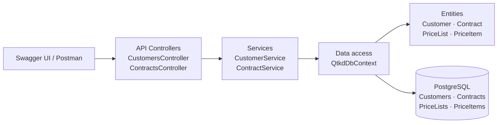

# Solution architecture — QTKD, Tuần 05

Controllers nhận HTTP request và trả HTTP response. Services xử lý các thao tác ứng dụng. `QtkdDbContext` dùng Entity Framework Core để đọc/ghi các entity trong PostgreSQL.
