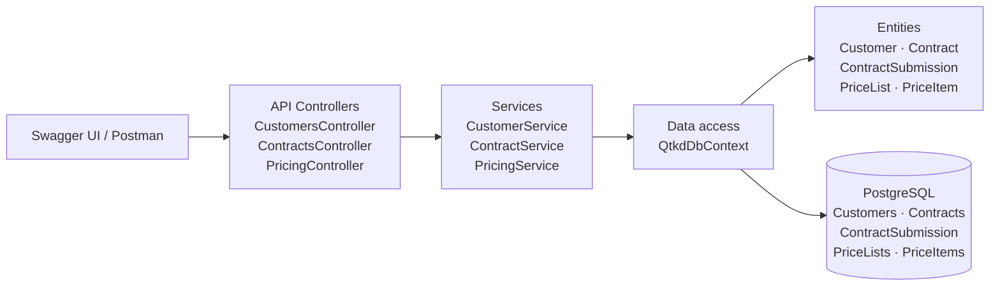

# Solution architecture — QTKD, Tuần 05–06

Controllers nhận HTTP request và trả HTTP response. Services xử lý validation và nghiệp vụ; `ContractService` chỉ cho sửa Draft/RevisionRequested và mô phỏng một lần bàn giao sang PendingApproval. `QtkdDbContext` dùng Entity Framework Core để đọc/ghi các entity trong PostgreSQL.
