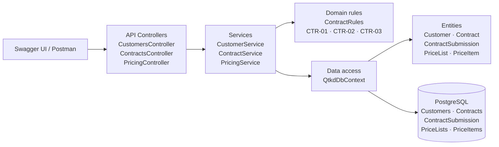

# Solution architecture — QTKD, Tuần 05–06

Controllers nhận HTTP request và trả HTTP response; mọi lỗi đều dùng chung dạng `{code, message, details}`. Services xử lý validation và điều phối nghiệp vụ. Các quy tắc hợp đồng nằm riêng trong `Domain/ContractRules.cs` (hàm thuần, không truy cập database, để unit test trực tiếp):

- `CanEdit` — CTR-01: chỉ sửa khi Draft hoặc RevisionRequested.
- `GetSubmissionErrors` — CTR-02: Customer Active, khoảng hiệu lực hợp lệ, nội dung/tệp (giả định demo).
- `CanTransition` — CTR-03: bảng chuyển trạng thái lấy từ sơ đồ máy trạng thái Phase 1; Draft → Approved không có trong bảng nên bị từ chối.

`ContractService` gọi các quy tắc này trước khi lưu và chỉ thực hiện chuyển Draft → PendingApproval. `QtkdDbContext` dùng Entity Framework Core để đọc/ghi các entity trong PostgreSQL; `Contract.Version` (cột hệ thống `xmin`) là concurrency token để hai request đồng thời không ghi đè nhau.
